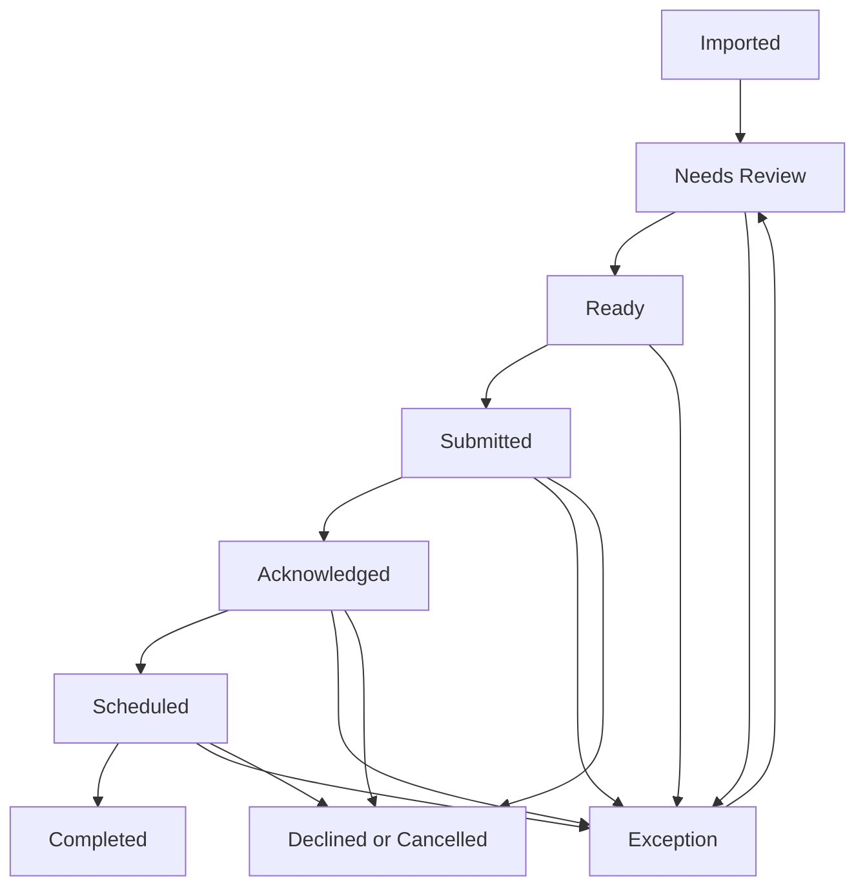
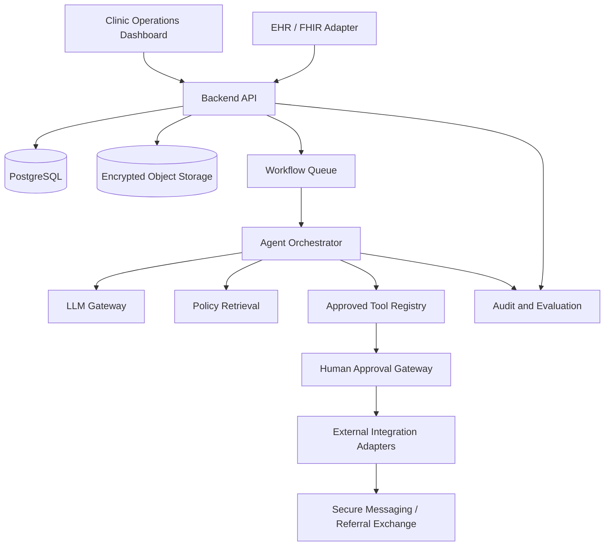

# AccessBridge AI — Startup Project & Requirements Specification

**High-Impact AI Agent Platform | Healthcare Technology | B2B SaaS | United States**  
**Status:** Proposed startup concept  
**Document type:** Product overview and implementation-ready requirements  
**Version:** 1.0 — October 21, 2026

> **Assumptions:** AccessBridge AI is a proposed product, not a documented operating company. All system capabilities, timelines, architectural choices, adoption goals, and performance metrics below are proposals. No existing customer, deployment, certification, or achieved business result is claimed. The initial product targets one U.S. clinic network, one supported referral intake integration, and selected outpatient specialist referral workflows.

## 1. Project Overview

### One-sentence description

**AccessBridge AI** is an agentic healthcare operations platform that helps community health centers coordinate patient referrals, automate administrative follow-ups, and connect patients with specialist care.

### Detailed project description

The product coordinates referrals from primary care to specialist services. It ingests referral records and supporting documents, checks for missing administrative information, prepares packets for human approval, tracks scheduling and follow-up, and records verified outcomes. The agent may recommend or execute specifically authorized administrative actions, but it does **not** diagnose, independently determine clinical urgency, prescribe treatment, or make unapproved consequential decisions.

### Project profile

| Attribute | Specification |
|---|---|
| Project name | AccessBridge AI (working title) |
| Industry | Healthcare, HealthTech, AI SaaS |
| Business model | B2B SaaS for healthcare organizations |
| Primary customers | Community health centers and primary care clinics |
| Primary users | Referral coordinators, patient navigators, clinic administrators |
| AI approach | Tool-using agents, LLMs, RAG, document intelligence, human-in-the-loop |
| Initial market | United States |
| Initial scope | Administrative coordination of outpatient specialist referrals |
| Long-term vision | Agent-assisted healthcare access and administrative coordination |
| Product type | Multi-tenant SaaS application with enterprise integrations |

### Business purpose and value

The central objective is to help more patients access specialist care recommended by their doctors while reducing repetitive administrative tasks for healthcare teams. After a patient is referred, the process may require documentation, insurance checks, communication with specialist offices, patient outreach, and follow-up. AccessBridge AI aims to make that journey visible and coordinated.

The product would:

- Ingest referral orders and supporting documents.
- Identify missing administrative information without inventing values.
- Prepare referral packages for staff approval.
- Track acknowledgment, appointment scheduling, and completion.
- Draft approved patient communications and record responses.
- Escalate ambiguous or sensitive cases to trained staff.
- Synchronize supported status changes with clinic systems.
- Provide an operational dashboard and audit history.

**Scope boundary:** The agent is an administrative coordination system, not a clinical decision-maker.

### Why this is potentially high impact

U.S. HRSA-funded health centers served approximately **32.7 million patients in 2025**, and approximately **90% of patients with known income** were at or below 200% of the federal poverty level, according to figures referenced from HRSA's 2025 Uniform Data System. These figures provide population context, **not** the startup's addressable customer count or projected adoption.

## 2. Business Context and Market Opportunity

### Industry background and business challenges

Referral coordination can span EHRs, patient portals, faxes, phone calls, spreadsheets, and specialist-office systems. Staff may have difficulty knowing whether a referral was received, scheduled, canceled, or completed. Patients may face language, transportation, affordability, and scheduling barriers.

### Existing/manual workflow

1. A primary care clinician creates a referral.
2. A coordinator verifies documentation, insurance details, and specialist destination.
3. Staff transmits the referral and seeks acknowledgment.
4. The specialist and patient coordinate scheduling.
5. Staff follows up and tries to confirm whether the appointment occurred.

This process can be labor-intensive and leave referrals with incomplete or unknown status.

### Proposed solution

AccessBridge AI maintains an authoritative administrative workflow record, highlights incomplete referrals, prepares tasks and communications, and guides staff toward verifiable completion. It automates only the bounded actions for which the organization has established authorization and policies.

### Competitive context

This is an **existing category**, not an unoccupied market. Examples include:

- **ReferralMD:** referral management, closed-loop tracking, communications, and automation offerings.
- **AristaMD:** specialist consultation and referral-routing services.

Proposed differentiation: a particularly strong fit for resource-constrained community health centers through lightweight integration, multilingual administrative support, traceable agent actions, exception management, and measurable outcomes.

### Business objectives

| Objective | Expected value |
|---|---|
| Reduce manual referral work | Allow staff to spend more time on complex patient needs |
| Improve referral visibility | Reduce records with unknown status |
| Support specialist access | Improve follow-through on recommended care |
| Reduce repeated communication | Streamline document and phone follow-ups |
| Improve accountability | Provide status history, ownership, and reporting |

These are hypotheses to test with real pilots rather than demonstrated product results.

## 3. Target Users and Stakeholders

| User / stakeholder | Responsibilities and goals | Pain points | Interaction with AccessBridge AI |
|---|---|---|---|
| Referral coordinator | Process and monitor referrals | Repetitive calls, missing paperwork, fragmented systems | Review packages, approve actions, resolve exceptions |
| Patient navigator | Help patients access appointments | Transportation, language, missed appointments | Review outreach, patient responses, assistance tasks |
| Clinic administrator | Manage staff and performance | Limited operational visibility | Dashboard, reports, configuration |
| Primary care clinician | Ensure referred care is received | Uncertain referral outcomes | View permitted referral status and specialist feedback |
| Patient | Complete specialty care | Confusing instructions, scheduling challenges | Receive approved messages and request assistance |
| IT/security administrator | Secure systems and integrations | Vendor risk, permissions, data exchange complexity | Configure connections, permissions, audit access |

**Primary paying customer:** The clinic or healthcare organization, not the individual patient.

## 4. Functional Requirements

**Priority definitions:** Must Have = initial MVP; Should Have = near-term expansion; Could Have = later roadmap.

### 4.1 Core platform and referral management

| ID | Feature/module | Requirement | Business value | Priority | User |
|---|---|---|---|---|---|
| FR-01 | Identity & access | Organization accounts, invitations, MFA, RBAC | Secure controlled access | Must Have | Admin |
| FR-02 | Multi-tenancy | Enforce clinic and organization data boundaries | Prevent unauthorized access | Must Have | IT |
| FR-03 | Intake | Import referrals through a supported EHR feed or approved file format | Reduce manual re-entry | Must Have | Coordinator |
| FR-04 | Tracking | Maintain unique records, document links, timestamps, status history | Reliable visibility | Must Have | Coordinator |
| FR-05 | Document AI | Classify documents and extract administrative fields with evidence references | Faster intake | Must Have | Coordinator |
| FR-06 | Validation | Flag missing administrative information using specialty checklists | Fewer incomplete packages | Must Have | Coordinator |
| FR-07 | Review | Enable correction and approval of agent-prepared referral packages | Accountable processing | Must Have | Coordinator |
| FR-08 | Tasks | Searchable task queue with owner, due date, priority and escalation | Prioritized operations | Must Have | Coordinator |

### 4.2 Agent and communication features

| ID | Feature/module | Requirement | Business value | Priority | User |
|---|---|---|---|---|---|
| FR-09 | Agent execution | Generate auditable action plans from approved workflows | Consistent execution | Must Have | Coordinator |
| FR-10 | Action controls | Verify permissions and collect approval for restricted external actions | Safe automation | Must Have | Clinic |
| FR-11 | Messaging | Draft and send authorized patient messages through permitted channels | Reduce follow-up time | Must Have | Navigator |
| FR-12 | Messaging state | Track responses, delivery failures, opt-outs and unresolved requests | Reliable communication | Must Have | Navigator |
| FR-13 | Outcomes | Record verified scheduling and completion evidence | Accurate referral outcomes | Must Have | Coordinator |
| FR-14 | Policy assistant | Search approved clinic procedures with source citations | Faster policy lookup | Should Have | Staff |
| FR-15 | Localization | Multilingual administrative messages with reviewed templates | Accessibility | Should Have | Patient |
| FR-16 | Voice automation | AI-assisted calls using authorized scripts and escalation | Expanded outreach | Could Have | Navigator |

### 4.3 Administration, analytics, integrations

| ID | Feature/module | Requirement | Business value | Priority | User |
|---|---|---|---|---|---|
| FR-17 | Dashboard | Report age, status distribution, unresolved exceptions and ownership | Operational visibility | Must Have | Administrator |
| FR-18 | Audit | Log state changes, approvals, data access and agent tool actions | Accountability | Must Have | Security team |
| FR-19 | Reconciliation | Reconcile inbound integration updates with local state and manual correction | Consistency | Must Have | IT |
| FR-20 | Configuration | Specialty-specific checklists and workflow rules | Adaptability | Should Have | Administrator |
| FR-21 | Reporting | Export authorized aggregate reports | Management analytics | Should Have | Leadership |
| FR-22 | Expanded integrations | Supported scheduling and eligibility systems | Less manual handling | Could Have | Coordinator |

**Design principle:** Every capability should solve a clear clinic workflow problem. Chat alone is not a substitute for durable state, permissions, verifiable evidence, and audit logs.

## 5. Non-Functional Requirements

All numerical values are **proposed engineering targets**, subject to pilot validation.

| Category | Proposed requirement |
|---|---|
| Performance | p95 ordinary API reads under 500 ms, excluding external calls |
| Agent processing | p95 analysis under 30 seconds for typical small referral packages |
| Scalability | Design target: 20 organizations and 100,000 referrals/month across tenants |
| Availability | 99.9% monthly uptime for dashboard and core APIs |
| Reliability | At-least-once job delivery, idempotent mutations, retries, dead-letter handling |
| Security | MFA, RBAC, tenant isolation, encrypted data, monitored security events |
| Privacy | Minimize PHI in prompts, traces, logs, and communications |
| Accessibility | WCAG 2.2 AA target for user-facing interfaces |
| Maintainability | Typed interfaces, automated tests, versioned schemas, IaC |
| Observability | Metrics, traces, structured logs, workflow and agent outcomes |
| Recovery | Proposed RPO 1 hour; RTO 4 hours |
| Data retention | Organization-specific schedules aligned with law, contract and clinical policy |
| Compliance | HIPAA-oriented policies, risk analysis, appropriate BAAs and controls |
| Cost | Meter model, messaging, document and infrastructure cost per workflow |

External EHRs and specialist systems have their own constraints. An unavailable system must not cause the platform to report that an action succeeded.

## 6. Core User Workflows

### Workflow A — Process a new specialist referral

- **Actor:** Referral coordinator assisted by intake and workflow agents.
- **Trigger:** New referral imported from an approved source.
- **Preconditions:** Valid source, authorized clinic, supported referral type.
- **Main flow:**
  1. Clinician creates a referral in the EHR.
  2. Integration imports the referral and permitted documents.
  3. AI extracts administrative fields and links values to source evidence.
  4. Rules check specialty-specific document requirements.
  5. Agent prepares the referral package and action plan.
  6. Coordinator reviews, corrects and approves the package.
  7. System transmits through an authorized route and records acknowledgment evidence.
- **Alternative flows:** Manual intake, manual corrections, partially complete records.
- **Exceptions:** Missing records, conflicting identity, unsupported destination, or transmission failure create human review tasks.
- **Outcome:** Documented submission or documented exception; never silent completion.

### Workflow B — Coordinate appointment follow-up

- **Actor:** Patient navigator and communication agent.
- **Trigger:** Submitted referral has no confirmation after a configured threshold.
- **Preconditions:** Authorized communication channel and verified contact preferences.
- **Main flow:**
  1. Examine current referral, appointment and communication state.
  2. Confirm consent/contact preferences and channel availability.
  3. Prepare outreach from an approved administrative template.
  4. Obtain required approval or use a previously authorized low-risk workflow.
  5. Send message and record delivery and response evidence.
  6. Classify response: confirmed, needs assistance, declined, unknown.
  7. Generate staff tasks for unresolved issues; update status only with evidence.
- **Alternative flows:** Patient calls clinic directly; coordinator confirms through specialist office.
- **Exceptions:** Opt-out, invalid contact, failed delivery, identity uncertainty, medical questions or urgent content cause suppression or human escalation.
- **Outcome:** Verified progress or a clear actionable task.

### Workflow C — Close the referral loop

- **Actor:** Referral coordinator and completion agent.
- **Trigger:** Specialist result or other permitted completion evidence arrives.
- **Preconditions:** Correct patient and referral matching.
- **Main flow:**
  1. Receive the result or completion evidence.
  2. Match it to the patient and referral.
  3. Agent proposes an evidence-linked state change.
  4. Apply validation and human review where required.
  5. Mark the referral completed and notify the authorized clinical team.
- **Alternative flows:** Specialist office manually confirms completion; delayed document arrives after closure proposal.
- **Exceptions:** Mismatched identifiers, duplicate notes, cancellations and absent proof remain unresolved.
- **Outcome:** Auditable evidence of **completed care**, which is distinct from an appointment merely being scheduled.

### Referral state model



`Exception` is an operational state, not a clinical outcome. State changes require valid transitions and audit history. Terminal outcomes may be corrected only through authorized workflows.

## 7. Use Cases and User Stories

| User story | Acceptance criteria |
|---|---|
| As a referral coordinator, I want automatic document checks so that I can identify incomplete referrals quickly. | Checklist configurable; missing values generate tasks; agent never fabricates values. |
| As a patient navigator, I want to find patients who need assistance so that they do not disappear from the workflow. | Follow-up queue reflects evidence, contact preferences and task ownership. |
| As a clinic administrator, I want unresolved referral metrics so that I can improve operations. | Reports filter by specialty, owner, status and age with consistent definitions. |
| As a physician, I want confirmed outcomes so that I know whether the patient received care. | Completion requires evidence, not message delivery alone. |
| As a security administrator, I want agent action logs so that I can investigate unexpected behavior. | External actions record actor, authorization, input reference, result and timestamp. |
| As a patient, I want understandable messages in my supported language so that I can take the next step. | Approved templates, permitted contact preferences and human assistance are available. |

## 8. Data Requirements

### Core entities

| Entity | Representative attributes |
|---|---|
| Organization | organization_id, name, configuration, retention_policy |
| User | user_id, organization_id, role, status, auth_identity |
| PatientReference | patient_ref_id, organization_id, EHR_patient_id, permitted contact attributes |
| Referral | referral_id, patient_ref_id, source_id, specialty, priority_from_source, status, created_at |
| ReferralDocument | document_id, referral_id, storage_uri, type, checksum, source_system |
| AgentRun | run_id, referral_id, workflow_version, model_version, status, timestamps |
| AgentAction | action_id, run_id, tool, argument_reference, authorization, result |
| Approval | approval_id, action_id, reviewer_id, decision, reason, timestamp |
| Communication | communication_id, referral_id, channel, template, consent_reference, delivery_status |
| ExternalProvider | provider_id, network_reference, location, contact_method |
| ReferralStatusEvent | event_id, referral_id, old_status, new_status, evidence_reference, actor, timestamp |
| AuditEvent | audit_id, organization_id, actor, operation, resource_ref, timestamp |

### Relationships and constraints

- An organization owns users and patient references; a patient can have multiple referrals.
- A referral can have multiple documents, agent runs, actions, approvals, messages and state events.
- Data access must be limited to an authorized tenant, role and legitimate workflow.
- Sensitive attributes should be encrypted and minimized.
- Cross-organization referrals require an explicit and authorized sharing arrangement.
- An AI decision must preserve links to input evidence and resulting authorized action.

### Data lifecycle

1. **Ingest:** Validate source, identity, organization boundary, schema and duplicate markers.
2. **Process:** Extract approved fields; attach provenance, uncertainty and validation outcomes.
3. **Operate:** Maintain event history, communications, approvals and current referral state.
4. **Reconcile:** Compare updates with authoritative source systems and resolve conflicts.
5. **Retain/delete:** Apply clinic-specific schedules, legal holds and backup lifecycle rules.

Reporting should use aggregate or appropriately de-identified data whenever feasible.

## 9. API and Integration Requirements

### Proposed REST API

| Method | Endpoint | Purpose |
|---|---|---|
| `POST` | `/v1/referrals/import` | Ingest an authorized referral |
| `GET` | `/v1/referrals` | Filter and paginate referrals |
| `GET` | `/v1/referrals/{id}` | Get an authorized referral view |
| `POST` | `/v1/referrals/{id}/analyze` | Queue validation and extraction |
| `GET` | `/v1/agent-runs/{id}` | Inspect execution progress and decisions |
| `POST` | `/v1/approvals/{id}/decision` | Approve or reject pending action |
| `POST` | `/v1/referrals/{id}/status-events` | Record evidence-backed state transition |
| `GET` | `/v1/reports/referrals` | Retrieve authorized operational metrics |

Requirements for mutations: strong authorization, input validation, audit records, idempotency where appropriate, and prevention of invalid status transitions.

### External integration contracts

| Integration | Purpose / data exchanged | Direction | Auth | Failure/retry strategy |
|---|---|---|---|---|
| EHR/FHIR | Referral and permitted clinical context; supported updates | Inbound/outbound | SMART OAuth 2.0 scopes or vendor-approved credentials | Retry reads, reconcile state, queue unsupported writes |
| Secure document exchange | Referral packages and specialist replies | Both | Mutual TLS, credentials or approved secure transport | Verify delivery, record failed attempts |
| Patient messaging | Approved messages and inbound responses | Both | API credentials and signed webhooks | Deduplicate, record delivery, respect opt-out |
| Scheduling | Available slots and appointment evidence where supported | Both | Vendor OAuth/API key | Human confirmation fallback |
| Identity provider | User identity and access | Inbound | OIDC/SAML | Fail closed on auth errors |
| Insurance eligibility | Eligibility status and verification timestamp | Primarily inbound | Authorized payer/clearinghouse connection | Mark stale/unverified, route to coordinator |

FHIR R4 `ServiceRequest` is useful for referral representation; `Task` can represent workflow status. Actual EHR write support, permissions and resource availability vary by deployment. The MVP should not promise universal EHR compatibility.

## 10. Technical Architecture

### Architectural approach

Use a **modular monolith with asynchronous workers** for the MVP. This favors simple operations and maintainable boundaries over early microservice proliferation.



### Suggested stack

| Layer | Proposed technology | Rationale |
|---|---|---|
| Frontend | React, TypeScript, Next.js | Maintainable typed workflow interfaces |
| Backend | Python, FastAPI, Pydantic | Structured API and AI tooling ecosystem |
| Database | PostgreSQL | Reliable transactional domain records |
| Durable workflows | Temporal | Long-running, retryable workflows with approval pauses |
| Cache | Redis (optional) | Caching, throttling and rate limits |
| Model access | Configurable LLM gateway | Provider flexibility and centralized controls |
| Agent tools | Typed Python interfaces | Restrict actions to validated approved tools |
| Documents | Text parsing, OCR if needed, structured extraction | Handle forms, scans and PDFs |
| RAG | PostgreSQL with pgvector, or simple indexed documents initially | Search approved policies |
| Object storage | Encrypted Amazon S3 | Durable document storage |
| Identity | Managed OIDC provider | Enterprise auth and MFA |
| Infrastructure | AWS ECS/Fargate, RDS, S3, KMS | Managed deployment primitives |
| CI/CD | GitHub Actions and Terraform | Automated checks and reproducible infrastructure |
| Telemetry | OpenTelemetry, metrics, centralized logs | Trace errors and agent actions |

Vendor selection is subject to PHI handling, security evaluation and necessary contract agreements.

### Architecture decisions

1. The **workflow engine** controls execution state; the AI suggests steps but does not supersede policy.
2. **PostgreSQL** is the operational source of truth; free-text AI output never directly overwrites state.
3. **Tool actions** pass through permission checks and approvals.
4. **Durable work** resumes after outages without duplicate transmission.
5. **Model and workflow logic** remain independently testable and replaceable.

## 11. AI/ML Requirements

### Agent capabilities

**Document Intelligence Agent**
- Problem: referral paperwork is variable and incomplete.
- Input: authorized referral forms and supporting documents.
- Processing: text extraction/OCR, classification and typed extraction.
- Output: candidate administrative fields with source spans and confidence metadata.
- Human validation: review low-confidence or critical ambiguous fields.
- Reliability: never fabricate missing values; preserve source evidence.

**Referral Workflow Agent**
- Problem: coordinators repeatedly determine next administrative steps.
- Input: validated referral state, rules, allowed tools, integration status.
- Processing: constrained planning followed by deterministic authorization checks.
- Output: task/action proposal or authorized workflow execution.
- Human validation: required for restricted external actions, identity ambiguity and exceptions.
- Reliability: typed tool schemas, idempotency, retry controls, hard state-transition rules.

**Patient Communication Agent**
- Problem: repetitive outreach and fragmented replies.
- Input: approved templates, referral state, preferences, permitted contact information.
- Processing: draft messages, classify administrative responses.
- Output: authorized reminders and escalation tasks.
- Human validation: concerning responses, medical questions and sensitive cases.
- Reliability: never imply medical advice, enforce opt-outs, log communications.

**Policy Retrieval Assistant (RAG)**
- Problem: staff must search disparate clinic procedure documents.
- Input: tenant-approved referral policies and staff queries.
- Processing: authorized retrieval and grounded generation.
- Output: answer with citations or explicit uncertainty.
- Human validation: policy owner reviews important answers and source changes.
- Reliability: avoid unsupported claims; protect against retrieved prompt injection.

### AI processing contract

| Component | Input | Output | Required controls |
|---|---|---|---|
| Extraction | Referral documents | Typed fields and source spans | Schema validation, reviewer correction |
| Planning | Referral state and approved rules | Proposed actions | Policy engine, auth checks |
| Messaging | Referral status and templates | Draft message | Privacy, contact, approval checks |
| Retrieval | Staff query and permitted SOPs | Cited answer | Access filtering, grounded evaluation |

### Example agent proposal

```json
{
  "referral_id": "ref_1042",
  "current_status": "SUBMITTED",
  "requested_action": "FOLLOW_UP",
  "agent_proposal": {
    "tool": "create_coordinator_task",
    "reason": "No acknowledgment recorded",
    "confidence": 0.94
  },
  "requires_human_approval": false,
  "external_message_sent": false
}
```

This is a **hypothetical internal event**, not actual production output. Confidence alone does not grant permission to act.

### Evaluation and agent safety

- Ground factual outputs in authorized input records or policies.
- Validate schema, field provenance and tool arguments.
- Treat uploaded and retrieved text as **untrusted input**.
- Prevent prompt injection from controlling authorization or tool scope.
- Escalate identity mismatches and ambiguous cases.
- Test on synthetic or appropriately authorized representative data.
- Log model/prompt/tool versions, corrections and decisions with PHI-safe boundaries.
- Limit token use, tool calls, runtime and maximum external-action scope.

The MVP does not require proprietary model training or fine-tuning. Good evaluations and reliable tools come first.

## 12. Security and Compliance

The platform is intended to serve healthcare organizations that may be HIPAA covered entities. The startup would generally need to assess its role as a **business associate** when handling protected health information for those clients and execute appropriate business associate agreements where required.

| Control area | Proposed requirement |
|---|---|
| Authentication | MFA, enterprise SSO when needed, appropriate session lifetime |
| Authorization | Tenant-aware RBAC and resource/action-level permission checks |
| Encryption | TLS in transit, encryption at rest, managed encryption keys |
| Secrets | Managed secrets, scoped service identities, rotation |
| Data minimization | Only share workflow-required PHI with approved services |
| Vendor management | Security assessments, BAAs where required, subprocessors tracked |
| LLM privacy | No training on PHI without appropriate authorization and agreements |
| Audit | Track data access, approvals, transmissions, state changes and actor identity |
| Incident response | Documented detection, containment, investigation and notification |
| Verification | Security risk analysis, penetration testing and access review |
| Patient messaging | Contact verification, permitted content, consent and applicable messaging rules |
| Backups | Encryption, controlled access, tested restores |

Regulatory analysis must be specific to the customer, relevant federal/state law, data involved and vendor roles. HIPAA controls are mandatory where legally applicable. SOC 2 may help procurement, but is not equivalent to HIPAA compliance and is **not** claimed as achieved.

## 13. MVP Scope

### Phase 1 — Must-have MVP

- Staff authentication and role permissions.
- One supported EHR or structured referral intake route.
- Referral record store and searchable dashboard.
- Document extraction, source evidence and validation checklists.
- Durable referral state machine and coordinator task queue.
- Staff review/approval of restricted agent actions.
- Approved administrative communication templates.
- Manual or integrated confirmation of referral outcomes.
- Audit logs, operational monitoring and core metrics.

This scope proves a single end-to-end administrative outcome without requiring broad nationwide integrations.

### Phase 2 — Post-MVP

- Additional EHR/referral exchange adapters.
- Multilingual administrative communication.
- Configurable specialty workflow packs.
- Richer policy retrieval and analytics.
- Expanded preauthorized automation.

### Phase 3 — Advanced

- AI-assisted phone coordination.
- Multi-clinic referral exchange networks.
- Insurance eligibility and prior authorization integrations.
- Verified provider matching.
- Delay prediction and assistance prioritization.

The CMS Interoperability and Prior Authorization Final Rule introduces specified payer API requirements generally beginning in 2027, but this **does not guarantee universal access** for a startup. The MVP should track authorization status rather than promise universal autonomous submissions.

## 14. Acceptance Criteria

These are **proposed preproduction and pilot gates**.

| Category | Proposed acceptance criteria |
|---|---|
| Functional | All successfully imported referrals create a traceable workflow record |
| Extraction | ≥95% precision and ≥95% recall on selected critical administrative fields in representative testing |
| Workflow | No invalid state transitions across automated validation suites |
| Agent safety | Zero unauthorized external actions in preproduction/adversarial tests |
| Tenant isolation | All tested cross-tenant access attempts rejected |
| Integration | Retries/duplicate deliveries do not create duplicate active work |
| Reliability | Failed external requests are retried or surfaced as unresolved |
| Auditing | Every external action links to actor, approval/authority and result |
| Performance | Section 5 pilot load and response targets met |
| Usability | Pilot coordinators complete supported flows without undocumented workarounds |

Operational launch also requires contracts, training, clinical-policy validation, security review and authorized customer approval. Test completion alone does not establish compliance.

## 15. Success Metrics and Unit Economics

### Pilot metrics

| Metric | Proposed target | Measurement |
|---|---|---|
| Staff handling time | 25% reduction | Median active minutes/referral versus baseline |
| Referral visibility | ≥95% | Referrals with verified state and assigned owner |
| Extraction precision | ≥95% | Correct critical extracted fields |
| Unresolved age | 20% reduction | Median time stuck in unresolved state |
| Referral completion | Improve relative to baseline | Verified completed-care percentage |
| Coordinator adoption | ≥75% | Eligible referrals processed through the platform |
| Agent proposal quality | Track by workflow | Approval rate without correction |
| Core availability | ≥99.9% | Monthly core uptime |
| Cost efficiency | Target positive unit economics | Cost per completed referral workflow |

**North-star metric:** Percentage of eligible referrals with verified completed-care outcomes within an agreed measurement window.

All numerical targets require baseline measurement and pilot validation; none are represented as achieved results.

### Business model

| Revenue stream | Proposed approach |
|---|---|
| Platform fee | Monthly per-clinic or per-organization subscription |
| Usage fee | Volume tiers based on referrals |
| Implementation | Integration and onboarding charge as appropriate |
| Advanced functions | Optional higher-volume voice/document/integration capabilities |

**Illustrative labor-value calculation:**

\[
\text{Monthly labor value} = \frac{\text{Referrals} \times \text{Minutes saved per referral}}{60} \times \text{Loaded hourly cost}
\]

Compare calculated value with subscription, implementation, staff review, infrastructure and messaging costs. Patient-outcome benefits should be reported separately from labor savings.

## 16. Risks and Mitigation

| Risk | Severity | Mitigation |
|---|---|---|
| Incorrect AI extraction | High | Source links, field validation, staff review |
| Incorrect patient identity match | Critical | Identifier validation, fail-closed mismatch review |
| PHI leakage | Critical | Tenant isolation, least privilege, vendor/model controls |
| Prompt injection | High | Untrusted data boundaries and constrained tools |
| Limited EHR features | High | Pilot vendor discovery, adapters, import fallback |
| Incorrect referral status | High | Evidence-based transitions and reconciliation |
| Patient messaging error | High | Approved templates, contact controls, escalation |
| Low coordinator adoption | High | Workflow interviews, usability testing and training |
| Lengthy healthcare sales cycle | High | Focused pilots, procurement planning and clear ROI |
| AI costs | Medium | Model routing, usage caps, evaluation-led optimization |
| Competition | High | Focus on underserved clinics, workflow depth and measurable value |
| Clinical safety incident | Critical | Nonclinical scope, human escalation, incident plan |

## 17. Development Phases and Roadmap

The following is an **illustrative 22+ week plan**, not a guarantee of deployment timing.

| Period | Phase | Major deliverables |
|---|---|---|
| Weeks 1–2 | Discovery and validation | User interviews, workflow maps, pilot scope, baseline metrics |
| Weeks 3–4 | Requirements and architecture | PRD, state model, APIs, data contracts, threat model |
| Weeks 5–10 | Core MVP development | Dashboard, state tracking, extraction, queues, approvals, tests |
| Weeks 11–14 | Integration and agent evaluation | Pilot adapter, AI benchmarks, privacy tests, runbooks |
| Weeks 15–18 | Controlled pilot | Staff onboarding, observed assisted workflows, pilot report |
| Weeks 19–22+ | Stabilization | Reliability fixes, security closure, optimization, next roadmap |

Security and contractual work must run throughout, and live-PHI readiness depends on appropriate approvals.

## 18. Engineering Team and Responsibilities

| Role | Suggested allocation | Responsibility |
|---|---|---|
| Founder / Product Lead | 1 | Customer discovery, product direction, partnerships, validation |
| Tech Lead / Backend Engineer | 1 | System design, APIs, workflow integrity and security architecture |
| Full-Stack Engineer | 1–2 | Dashboard, administrative flows, frontend/backend features |
| AI Engineer | 1 | Extraction, agent tools, evaluation and retrieval |
| Integration / Platform Engineer | 1 | EHR adapters, messaging, infrastructure and observability |
| UX Designer | Part-time | Workflow research, accessibility and usability |
| QA / Security Specialist | Part-time/contract | Test strategy, security review and control verification |
| Clinical Operations Advisor | Part-time | Referral practice review and escalation boundaries |

**Initial engineering team:** Roughly four to five engineers, a founder/product lead and domain advisors. Roles can overlap depending on team composition.

## 19. Interview / Resume-Relevant Technical Challenges

| Technical area | Challenge | Skills demonstrated |
|---|---|---|
| Distributed workflows | Prevent duplicate actions after retries/restarts | Temporal, idempotency, distributed systems |
| Backend API design | Enforce state transitions and action approvals | FastAPI, REST, domain modeling |
| Multi-tenancy | Keep organizations' data isolated | PostgreSQL, RBAC, access control |
| EHR integrations | Normalize inconsistent external resource and document schemas | FHIR, OAuth, adapters |
| Agent execution | Bound tool calls with deterministic safety checks | LLM orchestration, tool schemas, guardrails |
| Document extraction | Parse variable paperwork with verifiable fields | OCR, structured outputs, evaluation |
| RAG | Cite approved procedures rather than hallucinate | Embeddings, retrieval, grounding |
| Observability | Explain agent decisions and side effects | OpenTelemetry, traces, metrics |
| Cloud operations | Deploy secure, recoverable infrastructure | AWS, Terraform, CI/CD |
| Testing | Quantify agent failures and workflow correctness | Integration, evaluation and adversarial testing |

**Possible project discussion framing (not a claim of completed work):**

> Design an event-driven healthcare referral coordination platform integrating EHR data, durable administrative workflows and tool-constrained AI agents, with tenant isolation, human approvals, evidence-based state transitions and auditable execution.

Do not claim implemented functionality or quantified impact on a resume until verified.

## 20. Final Project Summary

| Dimension | Summary |
|---|---|
| Purpose | Reduce administrative friction preventing patients from reaching specialty care |
| Main users | Community health centers, referral coordinators, patient navigators and clinic administrators |
| Core features | Intake, document intelligence, task workflows, approved outreach, completion tracking, reporting |
| Architecture | React/TypeScript UI, FastAPI/Python backend, PostgreSQL, Temporal, AWS, EHR/FHIR adapters, LLM tools and scoped RAG |
| Challenges | Reliable AI actions, interoperability, PHI protection, long-running workflows and auditability |
| Business value | Less administrative work, clearer referrals and potentially better care coordination |
| MVP | One clinic network, supported intake route, document validation, coordinator queue and approved agent actions |
| Future opportunity | Voice outreach, additional integrations, multi-clinic coordination and specialty workflows |

### Strategic assessment

- **Impact potential: High.** The project addresses a consequential health access and operations problem.
- **Engineering complexity: High.** A compelling demo is much easier than a secure, dependable, interoperable production deployment.
- **Commercial opportunity: Promising but unvalidated.** Established competitors exist, and a startup must demonstrate distinct value and willingness to pay.

### Recommended first milestone

Build a complete referral intake and follow-up workflow with **synthetic patients**, a **simulated FHIR adapter**, a **document extraction agent**, and a **staff approval dashboard**. Evaluate completion correctness, auditability and human handling time before connecting live clinical systems.

---

## Source and Research Notes

These sources and standards were referenced in the initial project discussion. The descriptions above distinguish sourced industry context from the proposed solution; they do not establish that AccessBridge AI exists or has achieved results.

1. **Health Resources and Services Administration (HRSA), 2025 Uniform Data System:** healthcare center patient population and socioeconomic context.
2. **ReferralMD:** example of an established referral-management competitor.
3. **AristaMD:** example of specialty-care consultation and referral coordination offerings.
4. **HL7 FHIR R4:** `ServiceRequest`, `Task`, and relevant healthcare interoperability resources.
5. **HHS HIPAA guidance:** business associates, cloud services, security risk analysis, and audit controls.
6. **CMS Interoperability and Prior Authorization Final Rule:** applicable specified-payer API requirements and implementation schedule.

**Interpretation note:** Legal and technical integration requirements must be verified for each actual deployment, jurisdiction, clinical workflow and vendor. Numerical requirements in this document are proposed design or pilot targets unless explicitly identified as an external population statistic.
