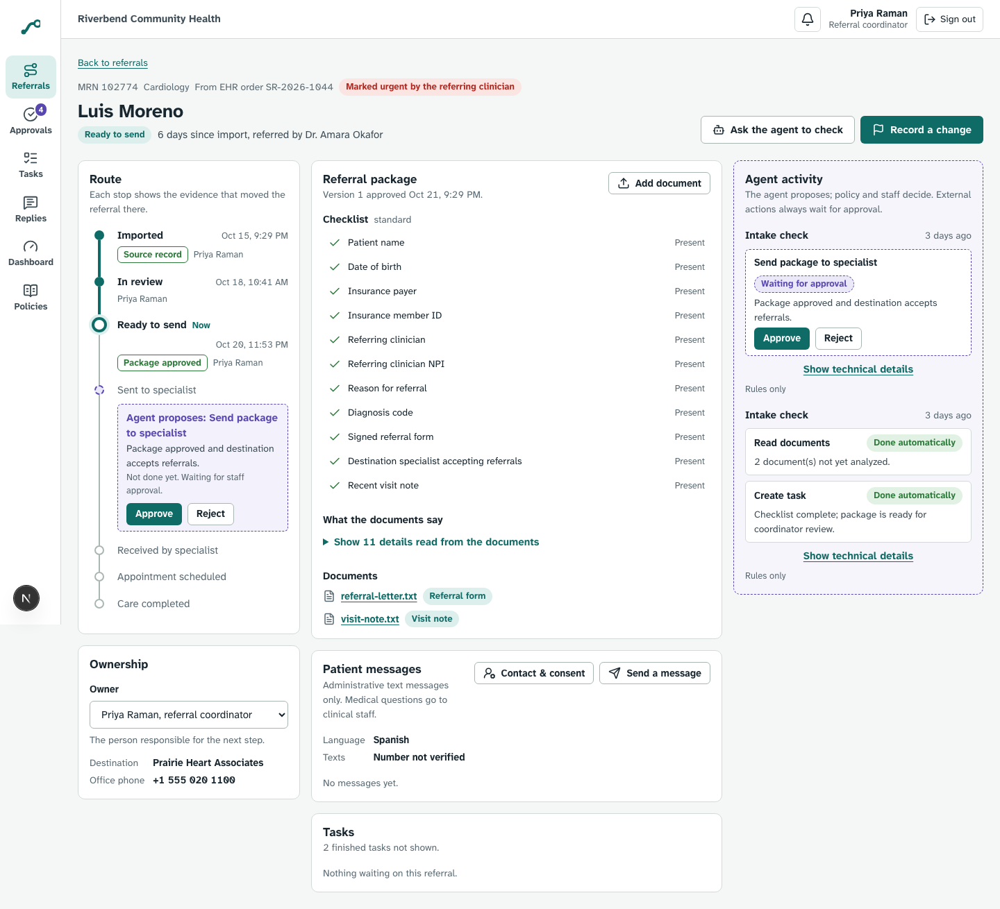

# AccessBridge AI

Agent-assisted coordination of outpatient specialist referrals for community health
centers. It imports referrals from the EHR, reads the paperwork, finds what's missing,
prepares packages for staff approval, follows up with specialist offices and patients, and
records verified outcomes.

**The agent proposes; deterministic policy, a durable state machine and people decide.**
It never diagnoses, never sets urgency and never takes an external action without
approval.

> A proposed product built with synthetic data only. No customers, deployments,
> certifications or results are claimed. See [safety and compliance](docs/SAFETY_AND_COMPLIANCE.md).



## What's in the box

| Capability | Requirements |
|---|---|
| Sign-in with two-step verification, roles, invitations, tenant isolation | FR-01, FR-02 |
| FHIR R4 and CSV intake with idempotent imports and identity checks | FR-03 |
| Referral route (state machine) with evidence for every step and full history | FR-04 |
| Document intelligence: classification and evidence-linked extraction that never invents values | FR-05 |
| Specialty checklists, missing-information tasks, package review and approval | FR-06, FR-07, FR-20 |
| Task queue with ownership, due dates and escalation | FR-08 |
| Agents with typed tools, a policy engine, approvals and durable retries | FR-09, FR-10 |
| Consented, multilingual patient messages; signed webhooks; reply classification with medical escalation | FR-11, FR-12, FR-15 |
| Evidence-based completion and reconciliation with specialist systems | FR-13, FR-19 |
| Policy assistant with citations | FR-14 |
| Dashboard, aggregate CSV export, audit log | FR-17, FR-18, FR-21 |
| Rate limits, security headers, metrics, retention with legal holds, migrations | §5, §12 |

## Quick start

```bash
./demo/run_demo.sh
```

Then open <http://localhost:3000>, organization `riverbend`, password `Demo-Password-2026`
(accounts and a guided tour are in [demo/README.md](demo/README.md)). For a narrated
end-to-end run in the terminal: `cd backend && uv run python ../demo/scenario.py`.

Production-like stack with PostgreSQL: `cp .env.example .env`, fill in the secrets, then
`docker compose up --build`.

## Documentation

| Guide | For |
|---|---|
| [User guide](docs/USER_GUIDE.md) | Coordinators, navigators, clinicians, security administrators |
| [Admin guide](docs/ADMIN_GUIDE.md) | Clinic administrators setting up and running AccessBridge |
| [Architecture](docs/ARCHITECTURE.md) | System design, data model, agent loop, decisions |
| [Developer guide](docs/DEVELOPER_GUIDE.md) | Setup, conventions, tests, extending tools and specialties |
| [API guide](docs/API.md) | Endpoints, auth, idempotency, webhooks, integrations |
| [Operations runbook](docs/OPERATIONS.md) | Deployment, configuration, monitoring, backups, incidents |
| [Safety and compliance](docs/SAFETY_AND_COMPLIANCE.md) | Scope boundary, AI controls, privacy, what a real deployment still needs |
| [Acceptance evidence](docs/ACCEPTANCE.md) | Spec §14 gates mapped to tests and measured results |
| [Design system](docs/DESIGN_SYSTEM.md) | Tokens, route line, encoding rules, accessibility |
| [Build plan](docs/PLAN.md) | How the project was phased |
| [Requirements](AccessBridge_AI_Project_Requirements.md) | The product specification |

## Stack

FastAPI · Pydantic · SQLAlchemy · PostgreSQL · Alembic | Next.js 16 · React 19 · TypeScript
| optional Claude (Anthropic API) behind an LLM gateway | pytest · Vitest · Playwright ·
axe-core | Docker Compose · GitHub Actions

## Tests

```bash
cd backend && uv run pytest               # 278 tests (SQLite; PostgreSQL via AB_TEST_DATABASE_URL)
cd frontend && pnpm test && pnpm test:e2e # 13 component + 9 end-to-end tests
```
