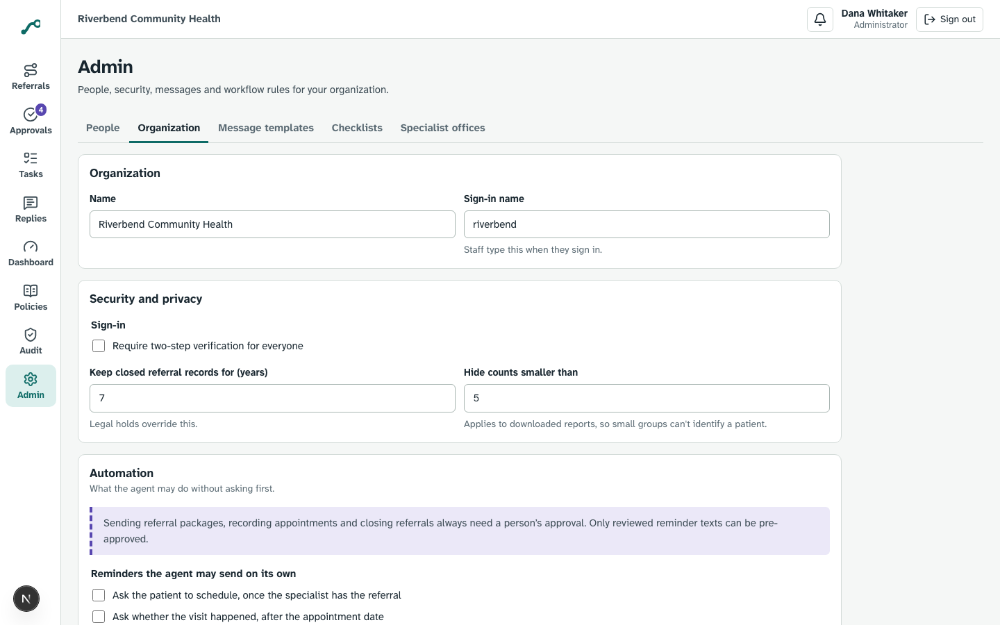
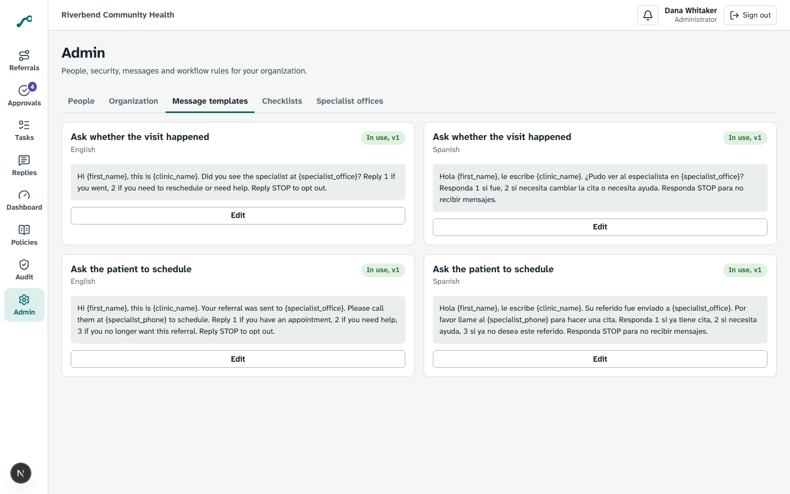
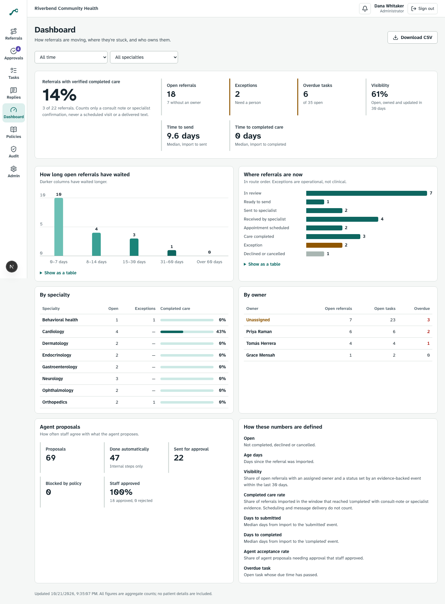

# Administrator guide

For clinic administrators setting AccessBridge up and keeping it running for their team.
Everything here is under **Admin** unless stated otherwise. Every change is recorded in
the audit log.

## First-time setup checklist

1. **Organization** → set the display name; turn on **Require two-step verification for
   everyone** before inviting staff.
2. **People** → invite your team with the right roles (below). Ask each person to set up
   two-step verification from **Your account**.
3. **Specialist offices** → add every destination, with network ID and phone, and mark
   whether each is accepting referrals.
4. **Message templates** → adopt the starting-point wording for each language you serve.
   A second administrator reviews each one.
5. **Checklists** → review the standard checklist per specialty; customize where your
   specialists need something different.
6. **Policies** → upload your referral procedures; a second person approves each.
7. **Automation** → decide whether any reminder texts may go out without approval (off by
   default).
8. Read the [operations guide](OPERATIONS.md) with whoever runs the servers: backups,
   secrets, monitoring and the model-provider decision.

## Roles

| Role | Can | Can't |
|---|---|---|
| **Referral coordinator** | Import and review referrals, approve packages and agent actions, record status changes with evidence, message patients, manage tasks, see reports | Manage users, change settings, read the audit log |
| **Patient navigator** | Message patients, manage contact and consent, handle replies, approve agent actions, record outcomes, manage tasks | Import referrals, approve packages |
| **Clinician** | See referral status and documents, search policies, get completion notifications | See contact details, message, change anything |
| **Administrator** | Everything coordinators can, plus people, settings, templates, checklists, offices, policies, exports, legal holds and corrections to closed referrals | Integration credentials |
| **Security administrator** | Read the audit log, manage people, manage integrations, see reports | Read referrals |

Role changes take effect immediately. The person's current session ends and they sign in
again with the new role. You can't change your own role or turn off your own access, and an
organization always keeps at least one active administrator.

## People

* **Create invitation** produces a one-time link valid for 7 days. Send it through a secure
  channel. The person chooses their own password (at least 12 characters with mixed case
  and a number).
* **Turn off access** ends sessions immediately; history is kept.
* The table shows whether each person has two-step verification and when they last signed in.

## Organization settings

| Setting | Effect |
|---|---|
| Require two-step verification | Sessions without a second factor can only reach **Your account** until they set it up |
| Keep closed referral records for | After this many years, a daily job purges documents, extracted values, message text and stale contact details from closed referrals. Status history and the audit trail stay. Legal holds override it. |
| Hide counts smaller than | Downloaded reports show `<N` instead of small counts so small groups can't identify a patient |
| Reminders the agent may send on its own | Pre-approves only the selected **reviewed** reminder texts for low-risk follow-up. Transmission, appointment recording and completion always need a person. |

## Message templates

* Two message types exist: **ask the patient to schedule** and **ask whether the visit
  happened**. English and Spanish starting points are provided; Vietnamese, Chinese, Arabic
  and Haitian Creole can be added.
* Placeholders: `{first_name}`, `{clinic_name}`, `{specialist_office}`, `{specialist_phone}`.
* Rules enforced on save: under 480 characters, must include "Reply STOP", no clinical
  wording (diagnosis, results, medication and similar), only known placeholders.
* Saving creates a new version that is **not used until a different administrator
  reviews it**. Reviewing puts it in use and retires the previous version.
* If a patient's language has no reviewed template, texts aren't sent and navigators get a
  task to call with an interpreter instead.

## Checklists

Each specialty has a standard checklist: patient name, date of birth, insurance payer,
member ID, referring clinician, reason, signed referral form and an accepting destination,
plus specialty items (for example, an imaging report for orthopedics or signed consent for
behavioral health). **Edit** to add, remove or relabel items and mark them required or
optional. **Use standard** reverts. New analyses use the latest version; referrals record
which version they were checked against.

Checklists are administrative completeness rules only. They never decide clinical need or
urgency.

## Specialist offices

Add the office name, specialty, how it receives referrals (secure exchange, FHIR or fax),
network ID, phone and languages spoken. Turning off **Accepting new referrals** blocks
approval of packages addressed to that office, and the agent flags ready referrals that
can no longer be sent there.

## Policies

Upload procedures as text, Markdown or text-based PDF. Uploads start as **drafts** and are
searchable only after a **different** staff member approves them. Uploading with an existing
title creates a new version; approving it archives the previous one. A passage that reads
like instructions to an AI (for example "ignore previous instructions") is flagged
**needs review**. It stays readable to people but is never sent to a model.

## Reports and exports

**Dashboard** shows open referrals by age, where referrals are now, specialty and owner
tables, time to send and to completed care, and how often staff approve the agent's
proposals. Definitions are shown on the page. **Download CSV** exports counts by specialty
and status only, with small counts hidden. Every view and export is audited.

## Legal holds and corrections

* **Legal hold:** `POST /v1/referrals/{id}/legal-hold` with a reason (administrators). Held
  referrals are never purged. Lifting a hold is also audited.
* **Correcting a closed referral:** open it and choose **Record a change**. Corrections
  reopen the referral as an exception with your reason; the original outcome stays in the
  history.

## When something goes wrong

| Symptom | Where to look | What to do |
|---|---|---|
| "Automated step failed and needs a person" task | Task detail; operations can see failed jobs | Fix the cause (for example an office address), then ask the agent to check again |
| Transmission failed | Exception reason on the referral | Correct the destination under Specialist offices, move back to review, approve again |
| Patients not receiving texts | Patient messages panel shows *Not sent* or *Not delivered* with the reason | Verify the number, record consent, add a reviewed template for the language |
| Someone locked out | Audit log `auth.login` | Locks clear after 15 minutes; check for password guessing |
