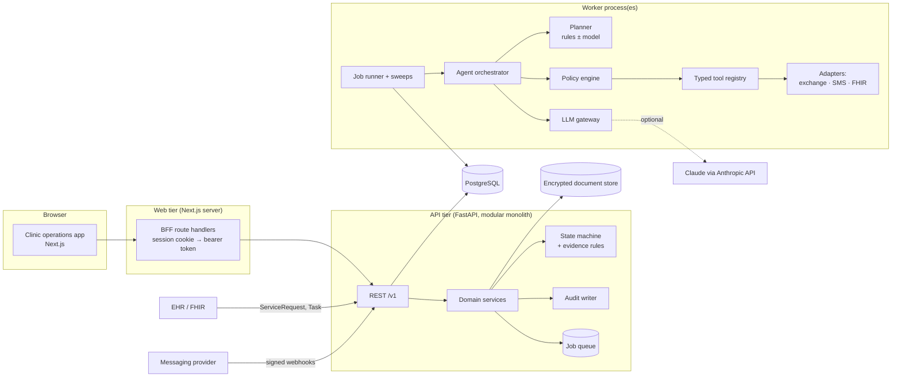
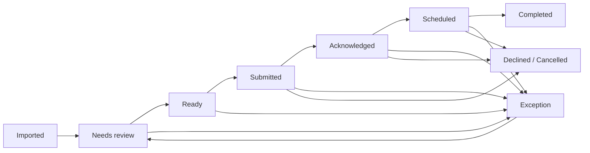
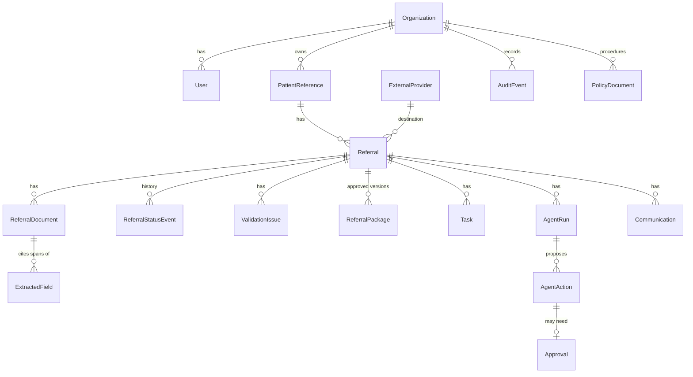

# Architecture

AccessBridge AI coordinates the administrative side of outpatient specialist referrals. Its
central design rule, taken from the requirements (§10), is:

> **The workflow engine and the state machine own execution. The AI only proposes.**

Everything below follows from that rule: AI output is never written straight into state,
every proposal passes a deterministic policy check, external actions wait for a person, and
every change carries evidence and an audit record.

## System overview



| Tier | Technology | Responsibility |
|---|---|---|
| Browser | React 19, Next.js 16 (App Router), SWR | Operations UI; never holds the API token |
| Web server | Next.js route handlers | Backend-for-frontend: session cookie, proxying, security headers |
| API | Python 3.13, FastAPI, Pydantic v2, SQLAlchemy 2.1 | REST API, validation, authorization, domain rules |
| Worker | Same codebase, `python -m app.workers.run` | Durable jobs, agent runs, sweeps (follow-up, escalation, retention) |
| Database | PostgreSQL (SQLite for local development and tests) | Source of truth for every record and the job queue |
| Documents | Content-addressed, Fernet-encrypted files | Stand-in for S3 + KMS |
| AI | `LLMGateway`: deterministic (default) or Anthropic | Optional extraction, planning, reply classification, policy answers |

Why a **modular monolith with workers** (spec §10): one deployable, one database, clear module
seams, and no distributed-transaction problems at pilot scale. The `WorkflowEngine` seam (the
job queue) can be replaced by Temporal later without touching domain code.

## Backend layout

```
backend/app/
  core/          config, db (UTC datetimes), security (scrypt, TOTP, JWT), crypto (field
                 encryption), tenancy, logging (PHI redaction), errors, metrics, rate limits
  models/        SQLAlchemy entities (spec §8): organization, user, referral, documents,
                 extraction, agents, communication, policy, audit
  domain/        pure rules: state_machine, rbac, checklists, templates
  services/      intake, referrals, validation, package, document_ai, reconciliation,
                 messaging, response_classifier, policy_rag, reports, retention, tasks, audit
  integrations/  fhir (R4 parser), simulated_ehr, exchange (secure transmission), sms
  agents/        tools (registry), policy (engine), planner, orchestrator
  ai/            gateway (providers, metering, caps), extraction (grounded quotes)
  api/v1/        routers; deps (principal, permission checks); idempotency
  workers/       queue (lease/retry/dead-letter), run (worker loop + sweeps)
  evaluation/    synthetic corpus + extraction precision/recall harness
  seed.py        synthetic clinic network, driven through the real API
```

Dependencies point inward: `api → services → domain`. `domain` imports nothing from the
rest of the app, so the rules that matter most (transitions, evidence, permissions) are
plain functions with exhaustive tests.

## The referral state machine



`app/domain/state_machine.py` encodes exactly these edges, plus:

| Entering | Evidence accepted | Notes |
|---|---|---|
| Ready | `package_approval` | Only via package approval, which snapshots an immutable package |
| Submitted | `transmission_receipt`, `manual_submission_note` | |
| Acknowledged | specialist acknowledgment, phone confirmation, FHIR Task | |
| Scheduled | appointment record, phone, **patient confirmation**, FHIR Task | Patient confirmation enters only through an approved agent proposal |
| Completed | **consult note**, specialist confirmation, FHIR Task | Message delivery and patient replies are rejected |
| Exception / Declined / Cancelled | reason required | Exception is operational, not clinical |

Terminal states reopen only through an **administrator correction**, which goes to Exception
with a reason and leaves the original outcome in history. Each referral also stores
`progress_status`, the furthest stop reached, so the UI can show where an off-route state
branched.

## Data model (spec §8)



Notable choices:

* **Every tenant-owned row carries `organization_id`.** Queries go through
  `core/tenancy.py` (`scoped`, `get_scoped`). Records in another tenant resolve as
  *not found*, so their existence never leaks.
* **Sensitive attributes are encrypted at rest** (`EncryptedString`): birth date, phone,
  email, extracted values, document text, message bodies and addresses.
* **Replies are matched without decrypting** using a keyed hash of the normalized phone
  number (`Communication.address_hash`).
* **Timestamps are always UTC-aware** (`UTCDateTime`), on every database.
* **Idempotency is structural:** unique keys on source references, integration events,
  jobs, agent actions, transmissions and messages.

## The agent loop

```mermaid
sequenceDiagram
    participant Q as Job queue
    participant O as Orchestrator
    participant P as Planner
    participant G as Policy engine
    participant T as Tool
    participant S as Staff
    Q->>O: agent.run (run_id)
    O->>P: state summary (ids and counts, no PHI)
    P-->>O: proposals (rules; model optional)
    loop each proposal
        O->>G: tool, args, workflow, state, budget
        alt denied
            G-->>O: denied + reason (recorded)
        else internal and allowed
            G-->>O: auto
            O->>T: execute (idempotency key)
        else external or state-changing
            G-->>O: approval required
            O->>S: approval task
            S-->>Q: approve → agent.execute_action job
            Q->>T: re-check state, then execute
        end
    end
```

* **Workflows:** `intake` (read documents, request review, propose transmission),
  `follow_up` (stale submissions, patient reminders, confirmed replies), `completion`
  (consult notes). Each has a fixed tool allowlist.
* **Tools** (`agents/tools.py`) have Pydantic argument schemas with `extra="forbid"`,
  allowed referral states, a risk class and an idempotent handler.
* **Policy** (`agents/policy.py`) never reads model confidence or document text. External
  tools always need approval, except reviewed reminder templates an administrator has
  explicitly pre-authorized. Transmission and every state change always need a person.
* **Budgets:** at most 8 tool calls and 1 external action per run, and a per-run token cap.
* **Approved actions re-check state before running**, so an approval can't revive a stale
  plan. Transient adapter failures retry with backoff; exhausted retries dead-letter, move
  the referral to Exception and create one task. An unavailable system never produces a
  success.
* **The planner never sees documents.** Only the extraction step reads document text, and
  its output is limited to field/quote pairs whose spans the code locates itself.

## Document intelligence

1. Text extraction: text files directly, PDFs with `pypdf`. Scans are marked *needs OCR*
   and routed to a person.
2. Classification by weighted keyword signals (referral form, insurance card, visit note,
   lab, imaging, consult note, consent).
3. Field extraction by label patterns with format checks (dates, Luhn-checked NPI, ICD-10),
   plus optional model-assisted extraction.
4. **Grounding gate:** a candidate is stored only if `text[start:end] == value`. Explicit
   blanks ("N/A", "unknown") are treated as missing, never as values.
5. Checklist validation per specialty (organization-overridable) produces issues and
   missing-information tasks. Identity mismatches block approval and can't be waived.

See [ACCEPTANCE.md](ACCEPTANCE.md) for the measured precision and recall.

## Messaging

`services/messaging.py` sends only when every check passes: consent on record, verified
contact, text as the preferred channel, a reviewed template in the patient's language, and
no identical message in the last three days. Failed checks become *suppressed* messages with
a task, never silent drops. Replies arrive through HMAC-signed webhooks (five-minute replay
window, event deduplication) and are classified. Opt-out and anything medical or urgent are
checked first. Replies from a phone shared by several patients are held for a person.

## Policy assistant (RAG)

BM25 over heading-aware chunks of the organization's **approved** procedures only. Answers
are extractive with numbered citations by default. A model may write the answer, but only if
every citation points at a passage it was given. Passages that look like instructions to an
AI are flagged at upload and never sent to a model. Below a term-coverage threshold, the
assistant says the answer isn't in the procedures.

## Frontend

* **BFF pattern:** the browser talks only to Next.js (`/api/session`, `/api/v1/*`). The
  backend token lives in an httpOnly, SameSite=Strict cookie. `proxy.ts` sends signed-out
  visitors to `/login`.
* **Typed API:** `src/lib/api-schema.d.ts` is generated from the FastAPI OpenAPI schema
  (`pnpm gen:api`).
* **Design system:** see [DESIGN_SYSTEM.md](DESIGN_SYSTEM.md).

## Key decisions

| # | Decision | Alternatives considered | Why |
|---|---|---|---|
| 1 | Database-backed job queue behind an interface | Temporal from day one | Same guarantees (lease, retry, dead-letter, idempotency) without another cluster for a pilot; Temporal can slot in later |
| 2 | Deterministic rules first, model optional | Model-driven planner | Works offline, testable, no PHI leaves by default; the model can only add proposals |
| 3 | Model returns quotes, code finds spans | Model returns offsets | Offsets from a model can't be trusted; locating quotes makes fabrication impossible to store |
| 4 | BFF with httpOnly cookie | Token in browser storage | Tokens never reachable by page scripts |
| 5 | SQLite for dev and tests, PostgreSQL in deployment | PostgreSQL only | Zero-setup development; the full suite also runs against PostgreSQL in CI |
| 6 | Not-found for cross-tenant ids | 403 | Doesn't confirm that another tenant's record exists |
