# User guide

For referral coordinators, patient navigators, clinicians and security administrators.
Administrators should also read the [admin guide](ADMIN_GUIDE.md).

AccessBridge keeps every referral on a **route**, from import to completed care, and shows
what proves each step. An agent does the repetitive checking and proposes next steps. It
never sends anything, contacts anyone or closes a referral without a person's approval.

## Reading the screen

| You see | It means |
|---|---|
| A row of stops on a line | **The route line.** Solid teal stops are done; the ringed stop is where the referral is now; hollow stops are still ahead. |
| Amber diamond dropping below the line | The referral left the route as an **exception** at that stop. A person needs to resolve it. |
| A bar across the line, faded stops after it | The referral was **declined or cancelled** there. |
| Green final stop | **Care completed**, proven by the specialist's note or confirmation. |
| **Dashed violet** box, field or stop | **Proposed by the agent or read automatically, not yet verified.** Nothing has happened yet. |
| **Solid** outline with a check | Verified by a person, or backed by evidence. |
| Red "per referring clinician" tag | Urgency stated by the referring clinician. AccessBridge never sets urgency. |

Text never carries meaning by color alone; every color comes with a label.

## Signing in

1. Go to your clinic's AccessBridge address.
2. Enter your **organization** short name (for example `riverbend`), your email and password.
3. If two-step verification is on, enter the 6-digit code from your authenticator app.

After five wrong passwords the account locks for 15 minutes. To turn on two-step
verification, open your name in the top bar (**Your account**) and follow the steps.

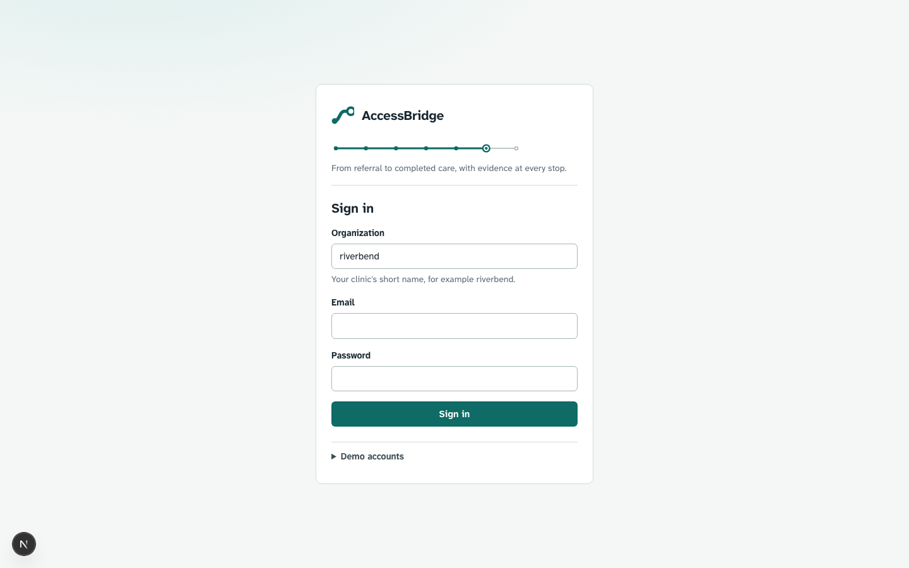

---

## Referral coordinators

### Your day starts in the queue

**Referrals** lists every referral with its route, specialty, owner, age and open tasks.

* **Needs action** (default): in review, exceptions and ready-to-send referrals.
* **With specialist**: sent, received and scheduled.
* **Closed**: completed, declined and cancelled.
* Filter by specialty or owner (**Mine**, **Unassigned**), search by name, MRN or ID, and
  sort by oldest or by time in the current step.

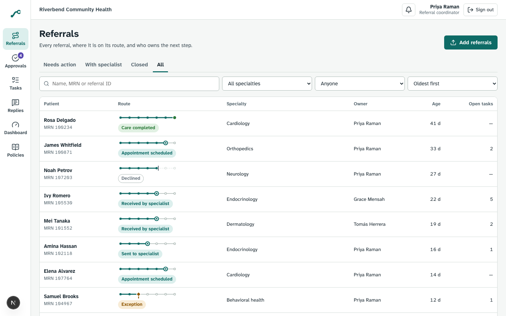

### Adding referrals

Most referrals arrive automatically from the EHR. To add others, choose **Add referrals**:

* **Import a CSV export.** Required columns are `source_id`, `ehr_patient_id`, `given_name`,
  `family_name` and `specialty`. The result shows how many were imported, which were already
  present (no new work is created for those), which need identity review, and any rows
  with errors. See `demo/data/sample-referrals.csv`.
* **Enter one by hand** for paper or fax referrals. Add the paper reference so duplicates
  are caught.

If the patient's name or date of birth disagrees with the existing record for that MRN,
the referral goes straight to **Exception**. Confirm identity with the referring clinic;
never merge records to make a mismatch go away.

### Reviewing a referral package

Open a referral to see three columns: the **route** (left), the **package** (center) and
**agent activity** (right).

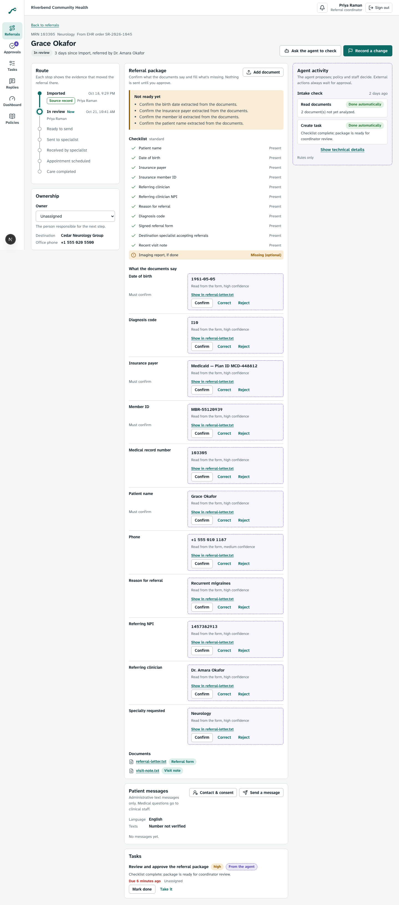

1. Choose **Ask the agent to check** if documents haven't been read yet. The agent extracts
   details and checks the specialty's checklist.
2. Work through the **checklist**. Missing items show in amber and each has a task. Add
   documents with **Add document**; the agent re-checks.
3. In **What the documents say**, every value shows where it came from. **Show in …**
   opens the document with the exact text highlighted.
   * **Confirm** values that are right. Patient name, date of birth, insurance payer and
     member ID *must* be confirmed.
   * **Correct** values that were misread. The original stays visible.
   * **Reject** values that don't belong.
4. When the checklist is complete, **Approve package**. This records exactly what was
   approved (a versioned snapshot) and moves the referral to **Ready to send**.

Waiving: an optional item can be waived with a reason. Identity, specialty and destination
problems can't be waived; fix the record instead.

### Sending, and other approvals

After approval, the agent proposes **Send package to specialist**. It appears as a dashed
violet stop on the route, in agent activity and in **Approvals**. Nothing is sent until you
choose **Approve**. If the exchange can't deliver, AccessBridge retries. If it still can't,
the referral becomes an exception with a task. It never reports a failed send as sent.

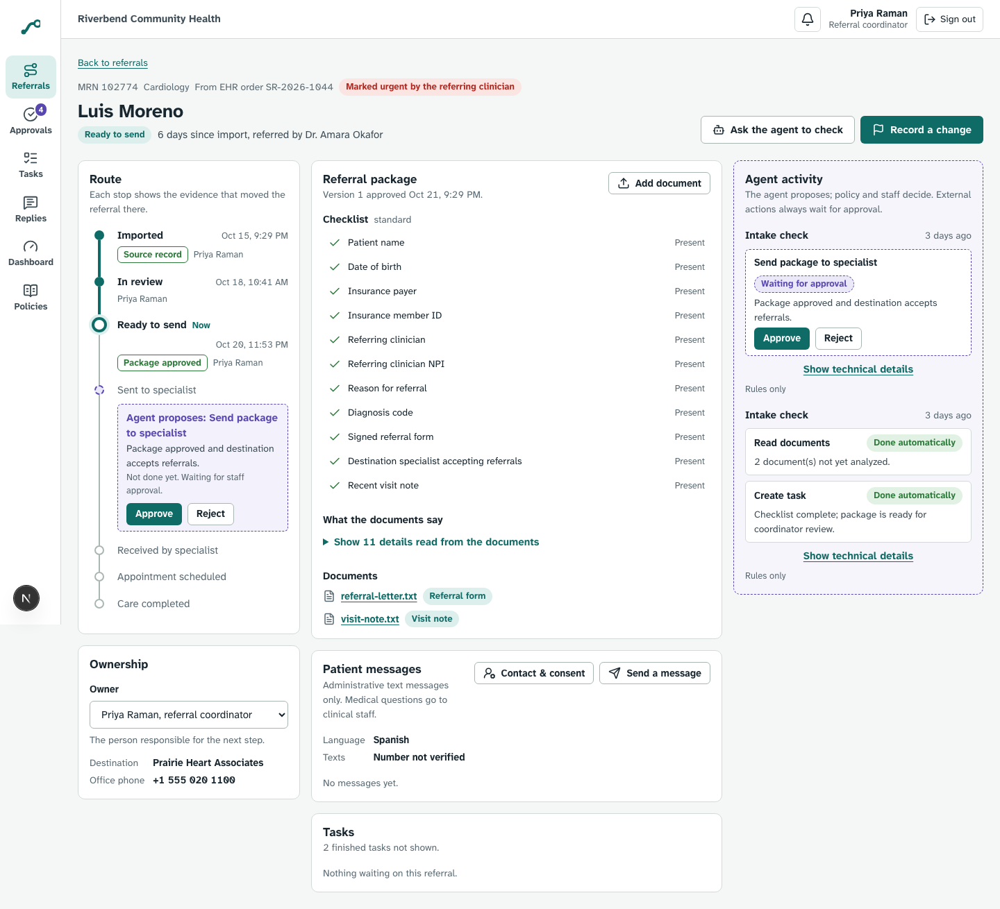

**Approvals** collects everything waiting for a person: transmissions, text reminders
(unless your organization pre-approved them), appointment confirmations from patient replies,
and completions from consult notes. Each card says why the agent proposed it and exactly what
will happen. Rejecting always asks why.

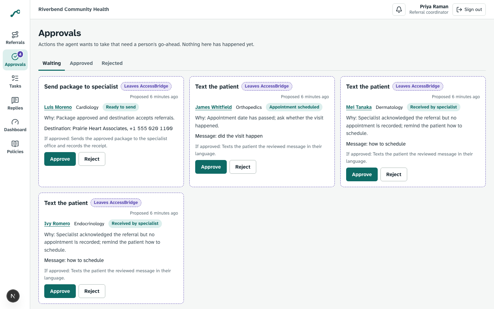

### Recording what happened

Use **Record a change** when you learn something outside the system, such as a phone call
with the specialist's office. The form only offers changes the rules allow from the current
step, and asks for evidence:

| To record | Evidence you can give |
|---|---|
| Received by specialist | Specialist acknowledgment, phone confirmation |
| Appointment scheduled | Appointment record, phone confirmation |
| Care completed | Consult note, specialist's written confirmation |
| Exception, declined, cancelled | A reason (and evidence for declined or cancelled) |

A delivered text or a patient saying "I went" is **not** proof of completed care.

### Exceptions

An exception means a person must act: an identity mismatch, a failed transmission, a
destination that stopped accepting referrals, or no response after repeated follow-ups. The
reason is shown at the top of the referral and on the route. Fix the cause, then choose
**Move back to review** in the package panel.

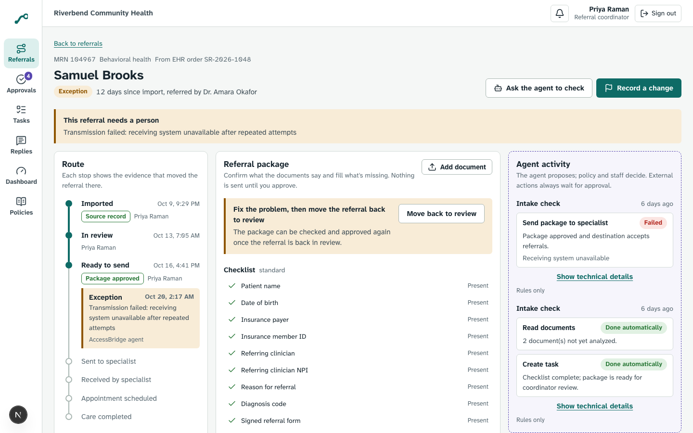

### Tasks

**Tasks** shows **Mine** by default, most urgent first. Overdue tasks are raised one priority
level per day. Use **Take it** to assign a task to yourself and **Mark done** with a note.
Tasks from the agent say so.

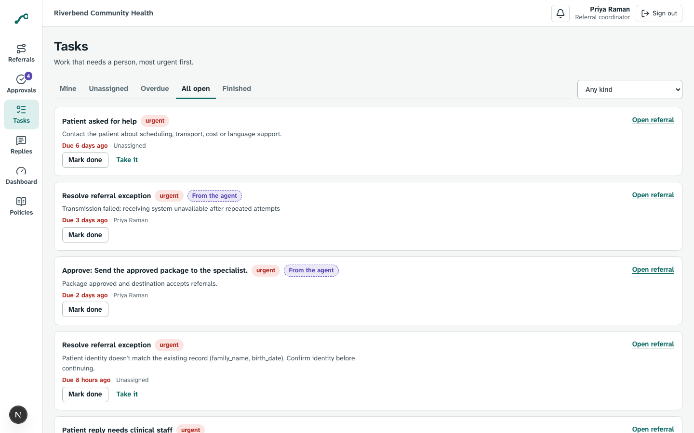

---

## Patient navigators

### Messaging a patient

In a referral's **Patient messages** panel:

1. **Contact & consent:** record where consent to texts is documented, confirm the number
   with the patient (**Number verified**), set the language and note interpreter or
   transportation needs. Changing the number clears verification.
2. **Send a message:** choose *Ask the patient to schedule* or *Ask whether the visit
   happened*. The preview shows the exact text in the patient's language. If something
   blocks sending (no consent, unverified number, no reviewed template in that language,
   opted out, or sent in the last three days), the reasons are listed and nothing is sent.

Messages are administrative only. They never include diagnoses, reasons or results.

### Replies

**Replies** lists texts from patients, with anything that sounds medical or urgent at the
top.

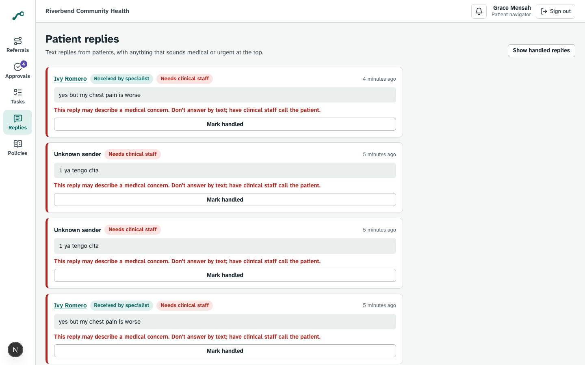

| Reply | What AccessBridge does |
|---|---|
| "1", "yes", "tengo cita" | The agent proposes recording the appointment; a person approves it. |
| "2", "need a ride", "ayuda" | Creates a high-priority task to contact the patient. |
| "3", "no longer want this" | Creates a task to confirm with the patient before closing. |
| "STOP" | Stops all texts to that patient immediately. |
| Symptoms, medication or urgent wording | **No automatic reply.** Creates an urgent task for clinical staff. |
| From a number shared by two patients | Held for a person; nothing is changed automatically. |

Don't answer medical questions by text. Have clinical staff call the patient, then **Mark
handled** with what you did.

---

## Clinicians

Clinicians can see every referral's route and status, read documents and search policies.
You'll get a notification (bell icon) when a patient you referred **completes care**, with
the evidence that proved it. Patient contact details, messaging and workflow controls are
hidden for this role.

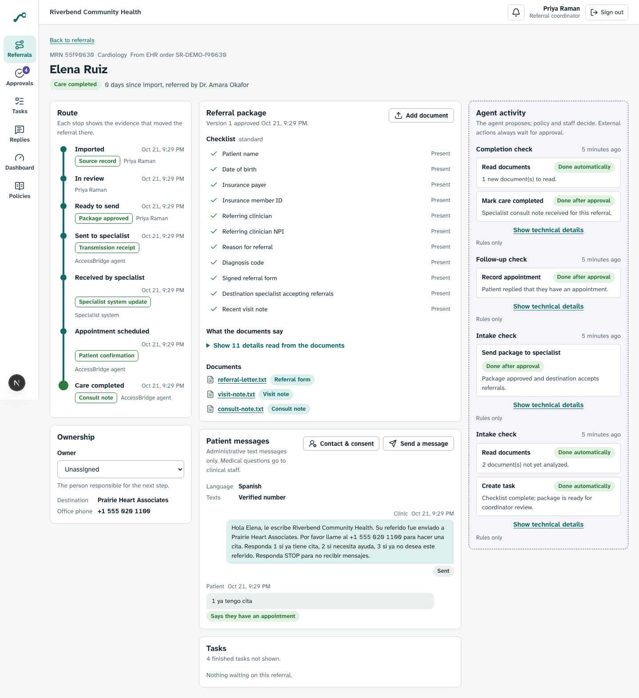

---

## Security administrators

**Audit** shows who did what, when, with what authority and with what result: sign-ins,
record views, document reads, agent proposals and actions, approvals, messages and
configuration changes. Filter by operation or record ID; open **View** for details.
Entries can't be edited or deleted.

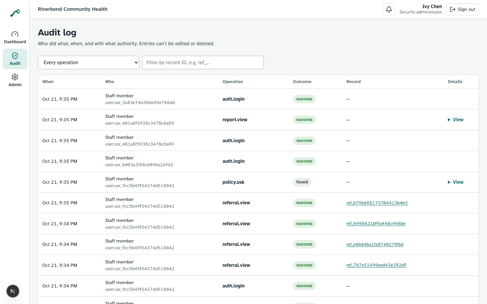

Things worth checking regularly:

* `auth.login` entries with outcome `denied` or `locked` (password guessing).
* `document.read` volume per person.
* `agent.action` entries: each external action shows `authorized_by` with the approval and
  the person who gave it.
* `user.*` and `organization.update` (who changed roles, MFA or automation settings).

---

## Policy assistant

**Policies** answers questions about your clinic's approved referral procedures. Answers
quote the procedure, with numbered links to the source passage and version. If the answer
isn't in an approved procedure, it says so rather than guessing. It never gives clinical
advice.

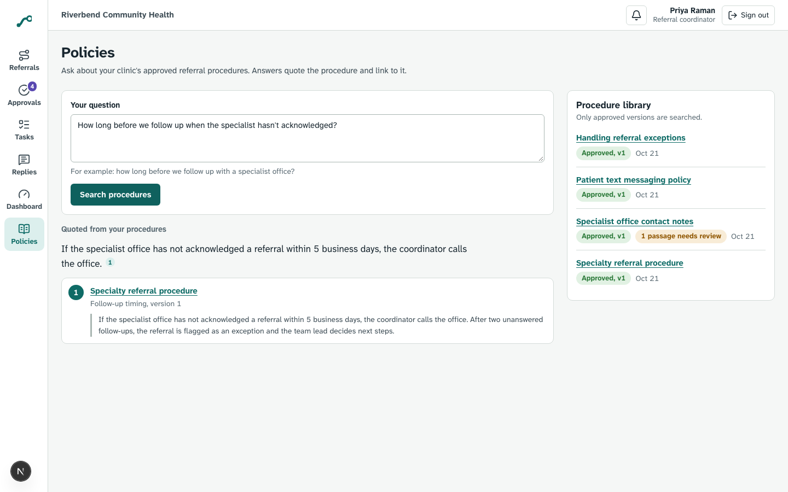

## Keyboard and accessibility

* Every action is reachable by keyboard, and focus is always visible. **Skip to main content**
  is the first tab stop.
* Screen readers announce the route as text (for example "Sent to specialist, stop 4 of 7").
* Charts on the dashboard have a **Show as a table** view.
* Dark mode follows your device setting.
